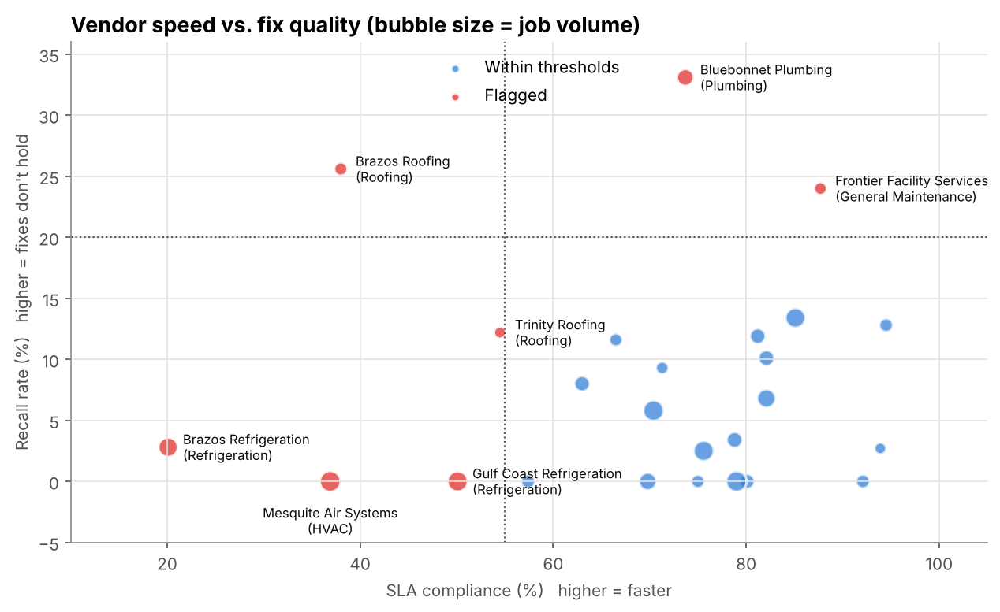
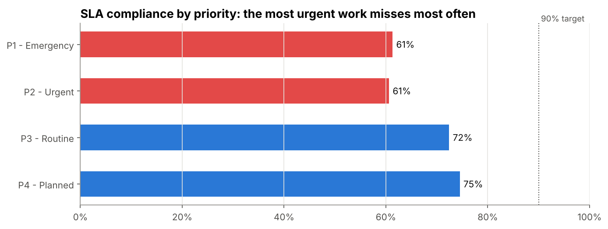
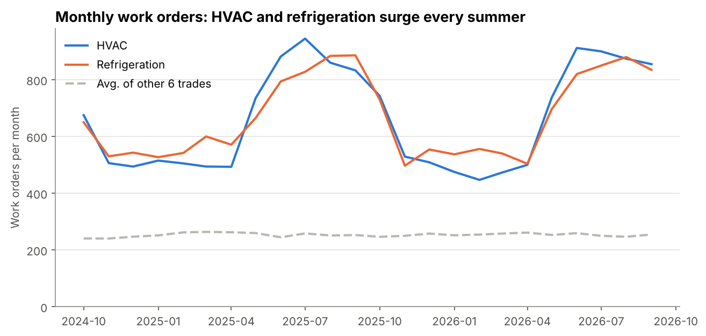
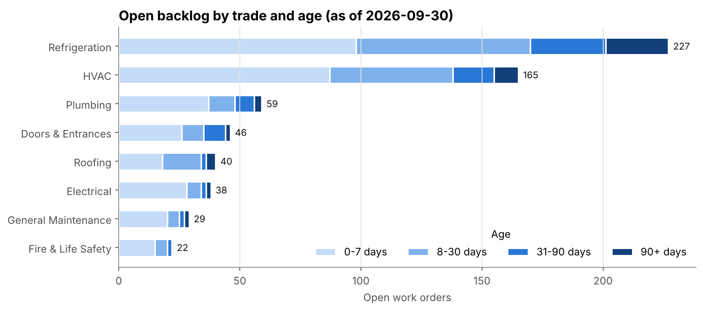

# Facilities Operations Analytics

**Where are a 120-store retailer's repair dollars and delays actually coming from, and what should leadership fix first?**

An end-to-end analytics project on ~68,000 facilities work orders (HVAC, refrigeration, plumbing, roofing, and more) across 6 Texas regions and 25 outside vendors over two years. Raw data is loaded into a SQL database, cleaned in a staging layer, analyzed with one SQL query per business question, and turned into charts and prioritized recommendations.

> All data is **synthetic**, generated by [`src/generate_data.py`](src/generate_data.py) to mirror real facilities-operations patterns (seasonality, aging stores, vendor quality differences, and messy source data). No real company data is used.

📓 **[View the full analysis notebook →](notebooks/facilities_operations_analysis.ipynb)**

---

## Key findings

| Metric | Result |
|---|---|
| Work orders analyzed | 68,354 |
| Total repair spend | $90.6M |
| SLA compliance (all priorities) | 68.7% |
| SLA compliance, P1 Emergency | 61% |
| Invoices over approved not-to-exceed (NTE) | 19.3% (~$7.4M over approved amounts) |
| Spend on recall visits (fix didn't hold) | ~$5.1M |

**1. Seven vendors cause half of all SLA misses.** They handle 31% of jobs but 50% of missed SLAs, and they fail in two distinct ways: some are slow but their fixes hold, others are fast but a quarter to a third of their jobs need a callback.



**2. Emergency work misses SLA most often.** P1 and P2 compliance (~61%) trails routine and planned work (72–75%), and the gap is consistent across every region, which points to vendor performance rather than regional staffing.



**3. HVAC and refrigeration surge every summer** (+82% and +55% vs. winter) and account for ~67% of all spend, so pre-season maintenance in April–May is the highest-leverage scheduling change.



**4. 19% of the open backlog is 30+ days old**, concentrated in refrigeration and HVAC.



**5. Stores 31+ years old generate ~25% more work per square foot** than stores under 10 years old.

## Recommendations

1. Put the 7 flagged vendors on performance plans and shift P1/P2 work to the top-ranked vendor in each trade.
2. Require root-cause notes and a 30-day warranty on recall-prone trades.
3. Enforce NTE approval before invoice payment (~$7.4M over approved amounts).
4. Schedule HVAC/refrigeration preventive maintenance and lock vendor capacity before summer.
5. Run a weekly review of 30+ day open work orders with vendors.
6. Prioritize the oldest stores in capital (replace vs. repair) planning.

---

## How it's built

```
raw CSVs ──► SQLite ──► stg_work_orders (cleaned view) ──► 6 analysis queries ──► notebook: charts + recommendations
```

**Data quality handled in the staging layer** ([`sql/00_stg_work_orders.sql`](sql/00_stg_work_orders.sql)):
- 15 distinct trade labels for 8 real trades (inconsistent casing) → trade taken from the vendor master
- 326 missing problem codes → labeled `Unknown` instead of dropped
- Cancelled work orders kept for volume but excluded from SLA, cost, and quality metrics
- Derived fields defined once: resolution hours, SLA met, over-NTE flag

**SQL techniques used:** CTEs, `LEFT JOIN` aggregation, `RANK() OVER (PARTITION BY ...)` window functions, conditional aggregation, date math, parameterized queries.

| Query | Business question |
|---|---|
| [`01_kpi_summary.sql`](sql/01_kpi_summary.sql) | Headline KPIs |
| [`02_monthly_trend.sql`](sql/02_monthly_trend.sql) | When does work come in? |
| [`03_sla_by_priority_region.sql`](sql/03_sla_by_priority_region.sql) | Are we meeting SLAs, and where not? |
| [`04_vendor_scorecard.sql`](sql/04_vendor_scorecard.sql) | Which vendors are fast, cheap, and fix it right the first time? |
| [`05_backlog_aging.sql`](sql/05_backlog_aging.sql) | What's stuck in the open backlog? |
| [`06_store_hotspots.sql`](sql/06_store_hotspots.sql) | Which stores generate the most work? |

## Repo structure

```
├── data/                  # generated CSVs: stores, vendors, work_orders
├── images/                # charts exported from the notebook
├── notebooks/
│   └── facilities_operations_analysis.ipynb
├── sql/                   # staging view + one query per business question
├── src/
│   ├── generate_data.py   # synthetic data generator (seeded, reproducible)
│   └── db.py              # loads CSVs into SQLite and runs the SQL files
└── requirements.txt
```

## Run it yourself

```bash
git clone https://github.com/adrianbutler1/facilities-operations-analytics.git
cd facilities-operations-analytics
pip install -r requirements.txt
python src/generate_data.py          # optional: data is already included
jupyter notebook notebooks/facilities_operations_analysis.ipynb
```

**Tools:** Python (pandas, NumPy, Matplotlib), SQL (SQLite), Jupyter

## Next steps

- Move the SQL layer into a **dbt** project with tests and a dimensional model
- Build an interactive **Tableau** dashboard on the staging view
- Train a model to **predict which new work orders will breach SLA** so dispatchers can intervene early
